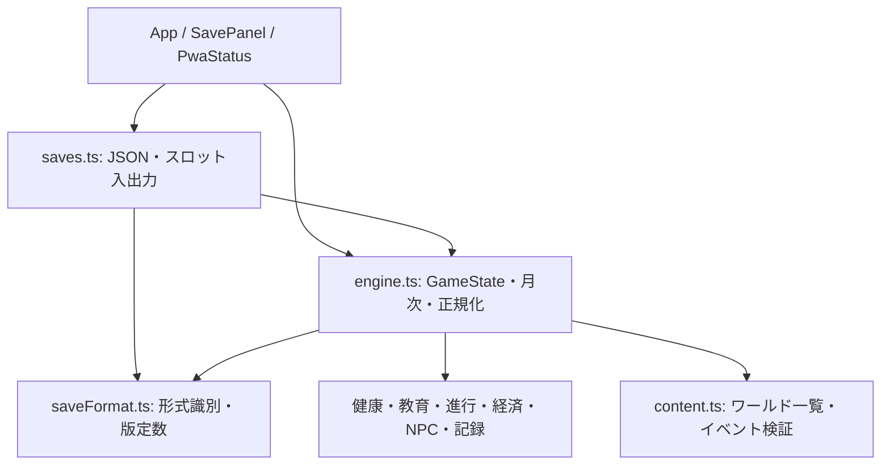

# P0-2 状態管理の責務と分割方針

対象：v2.0.0-beta.1、起点main `19104a60c5fbcc605a9751ede20d0cf290e354cd`（PR #2）。[確定ゲーム設計](GAME_DESIGN.md)、[回帰基準](REGRESSION_BASELINE.md)、[保存移行方針](SAVE_MIGRATION.md)に従う。

**実装済み**は以下の現行構造とP0-2の保存入力検査だけである。将来案のネストした状態、NPC自律行動、社会状態、世界ルール分離、シーン、乱数ストリーム分割は実装していない。GameStateの物理的な分割・一括書換えを今回は行わない。

## 1. 現行の状態と読み書き

`src/engine.ts`の `GameState` は `SocialState & Progression & Economy & School & Vitality & {...}` という交差型。実行時・JSONは同じフラットなオブジェクトで、ReactのAppが現在の状態を保持する。型名の領域と実際の責務は一致し切っていない。

| 領域 | 現行フィールド・型 | 初期化と主な読み書き | 注意点 |
|---|---|---|---|
| PCの基本・能力 | identity、traits、origin、stats（health/happiness/knowledge/sociability/money） | engine.newGame、identity/origins/traits、balance、applyEffects、UI | stats.moneyは経済、healthは健康が使う。v3の4層能力ではない |
| 健康 | stats.health/happiness、Economy.illness、Vitality.stress/illnessUntil/caregivingMonths/deathCause | healthMonth、経済の医療/家計、月次処理、UI | 型の配置が分散。PCの終了はfinished+deathCause、NPCはPerson.alive。死亡月固定はP1-1 |
| 時間・進行 | month、monthStarted、finished、priority、autoChoices、lastActionMonth、各last*Month | advanceMonth、choose、takeAction、meetPerson、教育/求職/家族決断 | monthは出生からの月数、単一の月次境界。pending時に停止し、chooseで同月の残処理へ戻る |
| 経済 | stats.money、Progression.debt/monthlyIncome/monthlyExpenses、Economyのsavings/investments/tax/expenseBreakdown等 | settleBudget、spend/transfer/restructure、就労/教育/健康 | 円単位の簡易モデル。購入枠と自主行動枠は別。今回係数・計算順は変更しない |
| 職業・教育 | Progressionのcareer/level/experience/education/partner等、jobId、SchoolのstudyPath/degree/club/workExperience等 | progressionMonth、schoolMonth、careerPrompt/choose、careers、education | Progressionに婚姻・家計も混在。School.flagsはゲーム全体の因果フラグに使用 |
| NPC・関係 | SocialState.people/relations/npcLinks/nextPersonId/lastSocialTick、PCのpartnerId/spouseId/children | initial/normalizeSocial、socialMonth/contact、npcMonth、家族決断、UI | relations.idはpeopleを参照。PCはpeopleに含まれず、NPC側のplayer参照等の特別値がある。4軸方向別・更新3段階は未実装 |
| イベント・保留 | pending（選択肢・任意personId）、queue（イベントID）、lastSeen、School.flags、Vitality.scheduled | selectEvents、advanceMonth、choose、delayedMonth、eventRules | queueはJSONのID、pendingは提示済み選択肢、scheduledは効果を含む保存データ。途中再開時に再抽選・再付与しない |
| 記録 | history、Vitality.timeline/logSequence/achievements | journal.record、updateAchievements、UI | historyは最大1500件、IDは単調増加。内部世界履歴とPCの知識はまだ分離されていない（P1-2） |
| 世界 | worldId、origin.region | newGame、content.WORLDS/loadWorld、App | manifest/eventsは別途読み込み、GameStateへ全データを埋め込まない。modern/coastalは制度共有。未知worldを別世界へ黙って置換しない |
| 乱数 | seed、birthSeed、initialIdentityChoice | engineのシード付きrandomと出生時draw、各領域へrandom callback | seedは続行状態、birthSeedは出生入力。旧データの不明はnull。UI時刻はモデル乱数に使わない。今回分割しない |
| 保存 | version、上記全体 | saves.export/import/saveSlot/loadSlot、engine.normalizeGameState、AppのlocalStorage | 自動保存はraw state、JSON/スロットはenvelope。キー/版は維持 |

## 2. 依存と実行順

領域モジュールは型としてGameStateを参照し、月次関数は渡された状態を更新する。engineの公開操作は原則cloneして返すが、領域の低水準関数を直接呼ぶ場合は呼び出し側が状態の所有に注意する。すべての関数を純粋関数へ変更したわけではない。

`advanceMonth` は進行停止を判定し、未開始の月のみ加齢/成長→遅延結果→健康→NPC→教育/職業→収支等の処理を行い、システム決断またはイベントqueueで中断する。`choose` は提示済み効果等を適用してpendingを解除し、同月の残queueを処理する。厳密な現行順序はソースを正とし、今回この順序・乱数消費・月境界を変えていない。

ロード時の `normalizeGameState` は進行コマンドではない。現在seedを保持して既存の不足フィールドを補完し、検証する。補完の基準となる `newGame(seed)` の初期化用抽選は保存された継続seedを書き換えない。出自が欠落した旧データの既定値は真の出生履歴の復元を意味しない。

## 3. P0-2で実装した最小変更

- `src/saveFormat.ts`：保存format、formatVersion、state versionの定数と、raw/envelopeの識別を領域更新から独立させた。ゲームのリリース版とは別の識別子である。
- `src/saves.ts`：文字列JSONを解析し、形式識別後のraw stateだけを既存正規化へ渡す。exportの形と値は変更しない。
- `src/engine.ts`：raw正規化へのenvelope情報混入を拒否。既存の形・有限値の検査に加えて、relationsのcloseness/trustが0〜100か、idがpeopleに存在するかを検査する。
- 新しい状態型・保存version・移行registryは導入しない。実在しない旧version用の変換器も追加しない。

UI・PWA・ゲームルールに変更はない。保存の識別・妥当性検査だけが強化され、破損値の補正や人物の生成・関係の削除は行わない。

## 4. 将来の分割案（未実装）

まず領域ごとの入力・出力と所有者を明確にし、serialize時のフラットv1互換性を保持するadapterの必要性を評価する。以下の名前は概念であり、確定した型名・保存パスではない。

| 将来の責務 | 分割候補と境界 | 担当する後続タスク |
|---|---|---|
| 人物 | PC/NPCの共通人物情報と、PCにだけ必要な操作/知識。能力4層と健康の所有を整理 | P2-1/P3-1〜2 |
| 時間・活動 | 月次進行、意図/実消費、月の予算、シーンの消費を統一し、経済等へ一度だけ反映 | P2-2/P5-1 |
| 社会・生活 | 関係、NPCの目標/行動、更新段階。社会6軸は別の共有状態として各領域から参照 | P3-1〜3/P4-1 |
| イベント | 提示済み選択と未処理queue、因果の履歴、遅延効果の責務を分ける | P0-3/P4-2/P5-1 |
| 記録・知識 | PC人生記録と内部世界履歴を分離し、公開判定を表示側任せにしない | P0-3/P1-2 |
| 世界 | 共通状態と教育/職業/貨幣/寿命等の世界ルールを分離。ルール自体と保存する識別子を区別 | P5-2 |
| 継続・保存 | ルール/コンテンツの版、乱数/履歴、各領域の移行。保存の識別は領域関数と独立 | P0-3以降の担当タスクで必要時に設計 |

実際に分割するタスクでは、領域の責務変更と保存レイアウト変更を同時に一括実施しない。影響を限定し、P0-1の再現・途中保存・世界読込・PWAの回帰を通してから次へ進む。v1と将来のレイアウト間にadapterを置くか、state versionを上げるかは現時点では未決定。

## 5. 継続して残る課題

`normalizeGameState` は初期化・互換補完・検証がまだ同じ関数にある。全体を機械的に別ファイルへ移すとnewGame、WORLDS、イベント検証、循環依存への影響が広がるため、今回行わない。歴史的な関係、親子のunknown/player参照、片側の婚姻情報、死亡月不明の扱いも自動修復しない。具体的な保留理由は [SAVE_MIGRATION](SAVE_MIGRATION.md) を参照する。

## P0-3追記

任意のrandomStreams（基盤のみ、月次への全面適用保留）とworldHistory（構造化事実）を追加した。P0-2時点の現状表は上に履歴として保存する。GameStateの一括分割はしていない。責務・互換性は [RANDOM_AND_HISTORY](RANDOM_AND_HISTORY.md) を参照。
